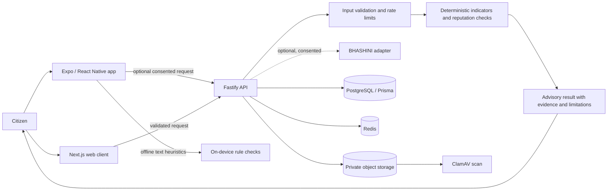

# JanVaani technical design

## Scope and trust boundary

JanVaani is a hackathon-stage citizen cyber-safety prototype, not a government
service, forensic product, or authority for identifying suspects. Its purpose
is to explain possible warning signs and guide people to safer next steps.
Automated output is advisory; it must not be used alone to accuse a person,
establish evidence, or make legal, financial, or emergency decisions.

## System context

Solid request paths represent the intended application structure. Dashed
external language-service use is optional and requires valid provider
credentials, explicit consent, and end-to-end verification. A module or Docker
service definition in the repository is not proof that a production service is
configured or operational.

## Components and responsibilities

| Component | Responsibility | Trust boundary / caveat |
| --- | --- | --- |
| `packages/mobile` | Android/iOS interface, learning material, language selection, local screening | Only English and Hindi UI dictionaries are currently supplied; other listed languages fall back to English. |
| `packages/frontend` | Next.js browser client | Treat all browser input and client-side checks as untrusted. |
| `packages/backend` | Fastify API, validation, detection orchestration, auth/privacy/upload modules | Requires configuration and security review; not production-certified. |
| `packages/shared` | Shared request/result types and enums | Types aid consistency but do not replace runtime validation. |
| PostgreSQL / Prisma | Structured application records | Schema presence does not prove migrations, access policies, or deployment readiness. |
| Redis | Optional cache/rate-limit/session support | Protect credentials and restrict network exposure. |
| MinIO/S3 + ClamAV | Private upload storage and malware scanning path | Do not upload sensitive citizen evidence in demos; verify quarantine, deletion, encryption, and scanner failure behavior before use. |
| BHASHINI adapter | Server-side interface for supported language services | Mock/dev integration until valid credentials, consent, and live tests are supplied. |

## Analysis flow

1. Validate the selected content type and enforce size/length limits.
2. Run the deterministic rules against text and extracted URLs; optional
   reputation or language stages run only when configured and permitted.
3. Return matched indicators, an advisory risk level, uncertainty, and safety
   guidance. Never infer the real-world identity of a caller from caller ID.
4. For media, malware scans are not deepfake detection. Authenticity scoring is
   experimental/not implemented as a validated production capability.
5. Direct users reporting financial cyber fraud to India's official
   [National Cyber Crime Reporting Portal](https://cybercrime.gov.in/) or
   **1930**; JanVaani does not file reports for them.

## Privacy and security controls to verify

- Keep secrets in local environment configuration or a managed secret store;
  never in frontend variables or Git.
- Request only the data needed for a check; avoid collecting Aadhaar, OTPs, UPI
  PINs, passwords, or continuous location.
- Obtain clear consent before sending any user content to an external service.
- Treat uploaded files and URLs as hostile input; validate type and size,
  quarantine files, scan them, and test deletion and retention behavior.
- Use least-privilege access, secure transport, rate limits, audit redaction,
  and reviewed production configuration.
- Provide human review and correction/reporting paths for consequential
  decisions; do not label a person as a fraudster based on an automated score.

## Build and deployment state

The repository describes a multi-package prototype. Follow the root README for
local setup. Before a public or government deployment, independently verify
the full build, migrations, authentication/session controls, access policy,
service availability, observability, disaster recovery, accessibility,
language quality, privacy/legal review, and penetration-test findings.

## Diagram maintenance

Update this document when package responsibilities, data flows, third-party
processors, retention rules, or security boundaries change. Keep diagrams free
of credentials and personal data.
